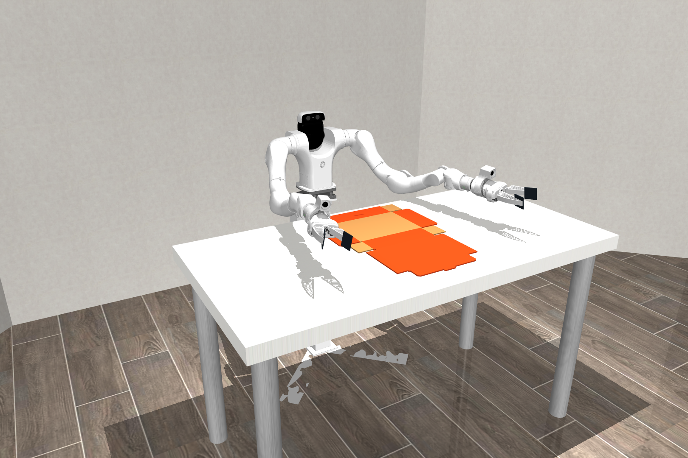

# Robot Agent Memory for Box Folding with RAX

What should a robot agent remember between attempts to fold a cardboard box?

I built a box-folding environment in MuJoCo, integrated the RAX robot-agent framework, and adapted its memory system for this task. The simulator pairs a Dexmate robot with a flat cardboard blank modeled as 14 rigid panels connected by 13 passive creases. My goal is to understand whether an agent can use evidence from earlier attempts to make progress toward folding the full box.

## Agent memory

Suppose a grasp fails. For the next attempt, I want the agent to be able to answer three questions. What did it try? What happened? Which observations support its explanation?

- **After an attempt**, the agent can record its hypothesis, actions, outcome, and references to evidence. It can save the current blocker and the next step in a journal that persists across episodes.
- **When work resumes**, the agent can recover its progress and check the current environment before reusing earlier parameters. The system tracks observations and hypotheses separately.
- **When a procedure looks reusable**, the agent can register a candidate skill with its preconditions and success criteria. Verification is a separate operator-controlled step.

[Integration code](https://github.com/emmaok1/RAX_folding-box/tree/c6f53525f5230164729d7d23927726692946f9a5/rax_integration) · [Memory tool and verification rules](runs/teacher_ready_20261103F/agent-workspace/.agents/skills/teacher-memory/SKILL.md) · [Example restore record](runs/teacher_ready_20261103F/agent-workspace/memory/RESTORE.json)

## Manipulation experiments

The simulator includes a table, cameras, a low-level motor controller, and a box model whose creases respond to contact. I use smaller tasks to study how the robot grasps, lifts, transports, and folds a panel. [Environment design](https://github.com/emmaok1/RAX_folding-box/blob/zhezhihe/DESIGN.md) · [Experiment code](https://github.com/emmaok1/RAX_folding-box/tree/zhezhihe/experiments)

**Single-crease fold.** With a fixture supporting the base, the robot grasped the side panel, folded it toward a 15° target, held it for 1.18 seconds, then returned and released it. All three runs completed the sequence from the same starting conditions. During the hold, the measured crease angle ranged from 14.12° to 14.57°. [Watch one trial](https://github.com/emmaok1/RAX_folding-box/blob/zhezhihe/validation/single_fold/run02/trial00/video.mp4) · [Read the measurements](https://github.com/emmaok1/RAX_folding-box/blob/zhezhihe/validation/single_fold/REPORT.txt)

A larger fold targeted 90°. The planning check stopped at 32°, before physical execution in the simulator, because the position error exceeded the specified tolerance. Full-box folding and the effect of cross-episode memory on task success remain open research questions. [Planning report](https://github.com/emmaok1/RAX_folding-box/blob/zhezhihe/validation/single_fold_90/REPORT.txt)

## Explore the repository

- **Run the simulation** following the [setup and launch instructions on the `zhezhihe` branch](https://github.com/emmaok1/RAX_folding-box/blob/zhezhihe/README.md). This branch contains the standalone simulation baseline and its experiments.
- **Inspect the RAX adaptation** in the [integration checkpoint](https://github.com/emmaok1/RAX_folding-box/tree/c6f53525f5230164729d7d23927726692946f9a5/rax_integration). The default branch holds [archived runs](runs/) and [planning validation records](planning_validation/).
- **View the project slides** for the robot, box geometry, and camera views. [Project overview (PDF)](https://github.com/emmaok1/RAX_folding-box/blob/zhezhihe/slides/Dexmate_Box_Folding_Summary.pdf)
